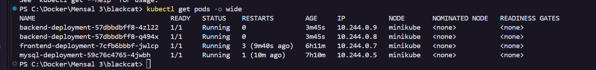
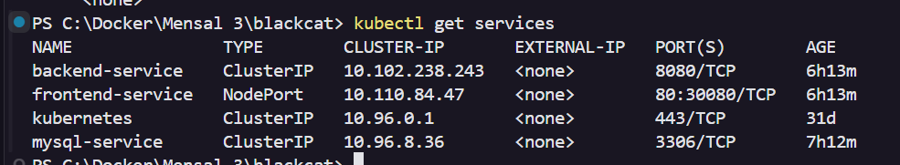
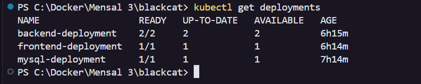
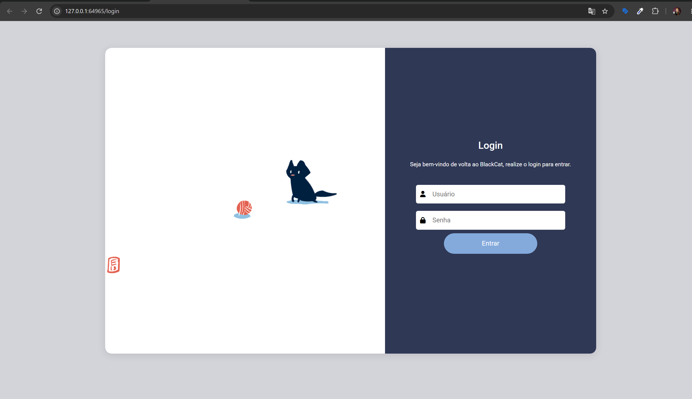

# BlackCat — Deploy em Cluster Kubernetes Local (Minikube)

Repositório de implantação da aplicação **BlackCat** (arquitetura em três camadas: Frontend Angular + Nginx, Backend Java Spring Boot e Banco de Dados MySQL) orquestrada 100% localmente utilizando **Kubernetes (Minikube)** e **Docker**.

---

## 📁 Estrutura do Projeto

```text
.
├── backend/                  # Aplicação Spring Boot (Java 17), Liquibase changelogs e Dockerfile
├── frontend/                 # Aplicação Web estática servida via Nginx (Proxy Reverso) e Dockerfile
├── mysql/                    # Configurações otimizadas do banco de dados relacional (my.cnf)
├── k8s/                      # Manifestos Kubernetes para o cluster local
│   ├── 01-mysql.yaml         # Secret, ConfigMap, Deployment (1 réplica) e Service ClusterIP (3306)
│   ├── 02-backend.yaml       # ConfigMap, Deployment (2 réplicas - HA) e Service ClusterIP (8080)
│   └── 03-frontend.yaml      # Deployment (1 réplica) e Service NodePort (80 -> 30080)
├── evidencias/               # Diretório destinado às capturas de tela da execução prática
├── .gitignore                # Regras de exclusão de versionamento Git
└── README.md                 # Documentação oficial de implantação e reprodução
```

---

## 1. Pré-requisitos

Certifique-se de possuir as seguintes ferramentas instaladas e operacionais na máquina local:

- **[Docker](https://docs.docker.com/get-docker/)** (v20.10 ou superior) — com o serviço/daemon ativo.
- **[Minikube](https://minikube.sigs.k8s.io/docs/start/)** (v1.30 ou superior) — cluster Kubernetes local.
- **[Kubectl](https://kubernetes.io/docs/tasks/tools/)** (v1.28 ou superior) — CLI oficial de gerenciamento do Kubernetes.

Verifique as instalações executando:

```bash
docker --version
minikube version
kubectl version --client
```

---

## 2. Inicialização do Minikube

Inicie o cluster Kubernetes local utilizando o **Docker** como driver de virtualização:

```bash
minikube start --driver=docker
```

Após a inicialização, valide se o nó do cluster encontra-se com status `Ready`:

```bash
kubectl get nodes
```

---

## 3. Construção das Imagens no Daemon do Minikube

Para que o Kubernetes utilize as imagens construídas localmente sem necessidade de enviá-las para um registry externo (Docker Hub / ECR), aponte o cliente Docker do seu terminal diretamente para o Docker Daemon interno do Minikube:

### No Linux / macOS / Git Bash (WSL):
```bash
eval $(minikube docker-env)
```

### No Windows (PowerShell):
```powershell
& minikube -p minikube docker-env --shell powershell | Invoke-Expression
```

Em seguida, a partir da **raiz do repositório**, execute o build das imagens do **Backend** e do **Frontend**:

```bash
# 1. Build da imagem do Backend (Spring Boot)
docker build -t blackcat-backend:latest ./backend

# 2. Build da imagem do Frontend (Nginx + Aplicação Web)
docker build -t blackcat-frontend:latest ./frontend
```

Confirme que as imagens estão disponíveis dentro do ambiente do Minikube:

```bash
docker images | grep blackcat
```

---

## 4. Ordem de Execução dos Manifestos Kubernetes (`kubectl apply`)

Aplique os manifestos respeitando a ordem de dependência entre as camadas (Banco de Dados $\rightarrow$ Backend $\rightarrow$ Frontend):

### Passo 4.1 — Camada de Banco de Dados (MySQL)
Cria o `Secret`, `ConfigMap`, `Deployment` (1 réplica) e o `Service` interno (`mysql-service:3306`):

```bash
kubectl apply -f k8s/01-mysql.yaml
```

Aguarde o Pod do MySQL atingir o status `Running` (`1/1`) antes de prosseguir:

```bash
kubectl wait --for=condition=ready pod -l app=mysql --timeout=120s
```

### Passo 4.2 — Camada de Aplicação (Backend Spring Boot)
Cria o `ConfigMap`, `Deployment` com **2 réplicas** (alta disponibilidade) e o `Service` interno (`backend-service:8080`):

```bash
kubectl apply -f k8s/02-backend.yaml
```

### Passo 4.3 — Camada de Apresentação e Proxy Reverso (Frontend Nginx)
Cria o `Deployment` e o `Service` do tipo `NodePort` (`frontend-service`) para exposição externa:

```bash
kubectl apply -f k8s/03-frontend.yaml
```

### Passo 4.4 — Verificação Geral do Deploy
Acompanhe o status de todos os recursos criados no cluster:

```bash
kubectl get pods -o wide
kubectl get deployments
kubectl get services
```

---

## 5. Acesso à Aplicação no Navegador

Para obter a URL externa de acesso ao `frontend-service` (exposto via `NodePort`) e abrir automaticamente a aplicação no navegador padrão, execute:

```bash
minikube service frontend-service
```

Caso deseje apenas exibir a URL gerada no terminal (sem abrir o navegador automaticamente):

```bash
minikube service frontend-service --url
```

> **Nota para usuários Windows / Docker Driver:** Mantenha a janela do terminal com o comando `minikube service frontend-service` aberta enquanto utiliza a aplicação no navegador, pois o driver Docker no Windows/macOS cria um túnel local dinâmico até o container do nó Minikube.

---

## 6. Evidências Práticas de Execução

Abaixo estão registradas as evidências de funcionamento do cluster Kubernetes e da aplicação rodando no Minikube.

### 6.1. Pods em Execução (`kubectl get pods -o wide`)
Demonstra o Pod do MySQL, as **2 réplicas** do Backend e o Pod do Frontend com status `Running` e seus respectivos endereços IP internos no cluster:



### 6.2. Services Configurados (`kubectl get services`)
Demonstra os serviços `ClusterIP` (`mysql-service` na porta `3306` e `backend-service` na porta `8080`) e o serviço `NodePort` (`frontend-service` na porta `80:30080/TCP`):



### 6.3. Deployments Ativos (`kubectl get deployments`)
Demonstra o estado desejado vs. estado atual (`READY`: `1/1` para `mysql-deployment`, `2/2` para `backend-deployment` e `1/1` para `frontend-deployment`):



### 6.4. Aplicação Funcionando no Navegador
Demonstra o acesso externo via navegador consumindo o Frontend (Nginx) integrado ao Backend (Spring Boot) e ao Banco de Dados (MySQL):


